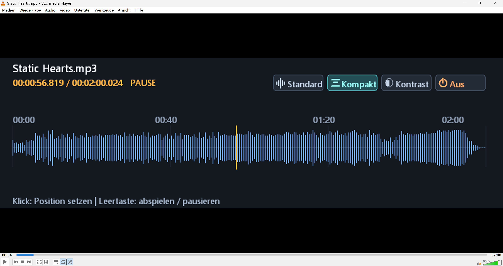

# VLC Waveform

**An independent, open-source waveform visualization plugin for VLC media player 3.x on Windows.**

VLC Waveform displays the waveform of an entire audio file directly inside VLC.

Click anywhere on the waveform to jump to that position. Playback remains paused when seeking from pause.

*Screenshot from version 1.0.4; the controls changed in 1.0.5.*

## Features

- Full-file waveform visualization
- Supported formats: WAV, FLAC, MP3 and M4A
- Click-to-seek navigation
- Preserves the paused state when seeking
- Contour, Pulse and Grid, each with a saved choice of eight colors
- Grid dots represent measured peak levels
- Optional slate markers for short, isolated claps (not guaranteed to catch every clap)
- Independently selectable HH, MM, SS, mmm and FF fields, with a separate frame-rate setting
- Enable/disable functionality
- Re-enable through VLC's Audio > Visualizations menu

## Requirements

- Windows 10 or newer, 64-bit
- VLC media player 3.x, 64-bit

Other operating systems and VLC 4.x are not supported.

## Notes

- If your files live on a network share: smaller MP3 files (up to 16 MiB) can use
  a small read-ahead buffer to avoid dropouts on slow connections. Local files
  are not affected.

## Download and Installation

Download the latest installer from the [GitHub Releases](https://github.com/ChrizzElabs/vlc-waveform/releases) section.

The offline installer requires no administrator privileges and installs the plugin for the current user.

After installation, open VLC and select the waveform visualization from the Audio > Visualizations menu (German UI: *Audio > Visualisierungen > Wellenform*).

A separate ZIP package is available for users who prefer a portable payload without the installer.

## Release 1.0.5

Re-enabling the waveform via the VLC menu starts in Contour. With hours hidden, the clock continues from 59:59 to 60:00. Old waveform caches are rebuilt on demand; a new analysis is saved only after a successful decoder exit.

## Security and Verification

The installer is not digitally signed.

Windows SmartScreen may display a warning. Some Windows security configurations may block unsigned applications.

SHA-256 checksums are provided for the release files (`SHA256SUMS.txt`). A checksum proves that a file is identical to the published one; it does not make a file trustworthy by itself. Trust comes from the published source code, the reproducible build documentation and the unchanged release files.

Full corresponding source code and license files are included in the distribution.

## Source Code and Building

The plugin is written in C.

The distribution includes FFmpeg 9.0.2 audio-decoding components.

This repository contains the plugin, installer and packaging sources plus build documentation (see `plugin/README.md`, `installer/README.md`, `decoder/README.md` and `QUELLEN.txt`).

The release contains a separate, complete source archive, including the corresponding sources for the distributed components: upstream source archives, toolchain runtime sources and LGPL relink objects. Those large archives are intentionally not stored in this repository; they are part of the release asset `VLC-Waveform-Quellen-1.0.5.zip`.

## Licensing

VLC Waveform is licensed under GPL-2.0-or-later.

The bundled FFmpeg components are distributed under their applicable licenses, including LGPL-2.1-or-later.

See the included license files for details.

## Disclaimer

VLC is a trademark of VideoLAN.

VLC Waveform is an independent third-party project.

It is not developed, maintained, affiliated with or endorsed by VideoLAN.

## Feedback

Bug reports and suggestions are welcome through GitHub Issues.
